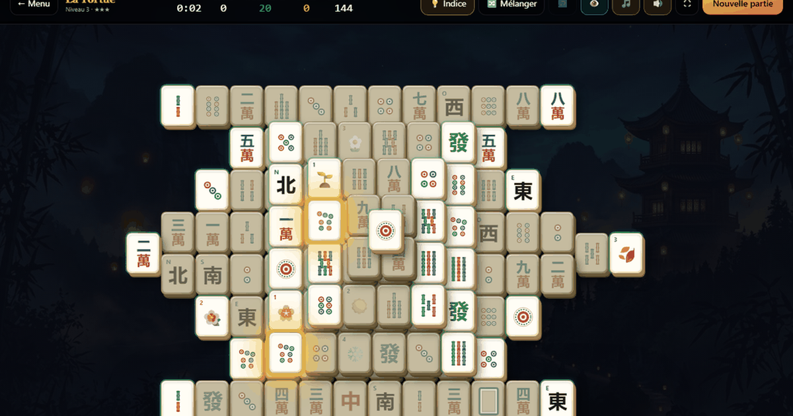

# Deux par Deux

**Le solitaire de tuiles. Cinq plateaux, toujours résolvables.**

Joue ici : [games.hylst.fr/deuxpardeux/](https://games.hylst.fr/deuxpardeux/)



## Comment on joue

Retire les tuiles deux par deux en cliquant sur deux tuiles **identiques** et **libres**.

Une tuile est libre si rien ne la recouvre et si au moins un de ses deux côtés (gauche ou
droite) est dégagé. Les tuiles libres sont mises en valeur en clair avec un liseré vert, les
tuiles bloquées restent grisées. Videz le plateau pour débloquer le suivant.

Les fleurs se marient entre elles, les saisons aussi : pas besoin qu'elles soient identiques.

## Les cinq plateaux

| Niveau | Nom | Tuiles | Difficulté |
|--------|-----|--------|-----------|
| 1 | Initiation | 42 | ★☆☆☆☆ |
| 2 | Jardin de Bambous | 72 | ★★☆☆☆ |
| 3 | La Tortue | 144 | ★★★☆☆ |
| 4 | La Forteresse | 114 | ★★★★☆ |
| 5 | Le Dragon Céleste | 124 | ★★★★★ |

Chaque plateau est généré par placement inverse : le jeu construit la partie en la
« déjouant » à l'envers, ce qui garantit qu'une solution existe toujours.

## Les outils

| Bouton | Effet |
|--------|-------|
| 💡 Indice | Surligne une paire jouable (−5 points) |
| 🔀 Mélanger | Redistribue les tuiles restantes en gardant le plateau résolvable (−10 points) |
| ↩ | Annule le dernier coup (−10 points) |
| 👁 | Active ou coupe la mise en valeur des tuiles libres |
| 🎵 / 🔊 | Musique d'ambiance et effets sonores |
| ⛶ | Plein écran |

## Ce qu'il y a dedans

- 5 plateaux à difficulté croissante, débloqués au fur et à mesure
- Génération toujours résolvable, y compris après un mélange
- Détection automatique de blocage, avec proposition de mélanger ou d'annuler
- Meilleur temps enregistré par plateau
- Faces de tuiles dessinées en SVG (cercles, bambous, caractères, vents, dragons, fleurs, saisons)
- Musique d'ambiance et effets sonores générés à la volée en Web Audio

## L'arborescence

```
deux-par-deux-game-development/
├── index.html          # template + bloc SEO
├── vite.config.ts      # base '/deuxpardeux/' + singlefile
├── public/
│   ├── favicon.png
│   ├── og-image.png / og-image.webp
│   └── icon.webp        # carte du menu, 128x128
└── src/
    ├── main.tsx
    ├── App.tsx           # ecrans, etat de partie, rendu du plateau
    ├── layouts.ts        # les 5 plateaux + generation resolvable + regles de liberte
    ├── TileFace.tsx      # dessin SVG des faces de tuiles
    ├── audio.ts          # synthese Web Audio
    ├── index.css         # Tailwind + animations
    └── assets/bg.jpg     # decor de fond
```

## Dev

```bash
npm install
npm run dev       # http://localhost:5173/deuxpardeux/
npm run build     # dist/index.html, un seul fichier
npm run preview
```

## Stack

React 19, TypeScript 5.9 (strict), Tailwind CSS 4, Vite 7, vite-plugin-singlefile.

Zéro backend. Les faces de tuiles sont du SVG, les sons sont synthétisés au vol : le seul
asset binaire est l'image de fond.

## Licence

AGPL-3.0-or-later, Geoffroy Streit (Hylst). Voir `LICENSE`.
